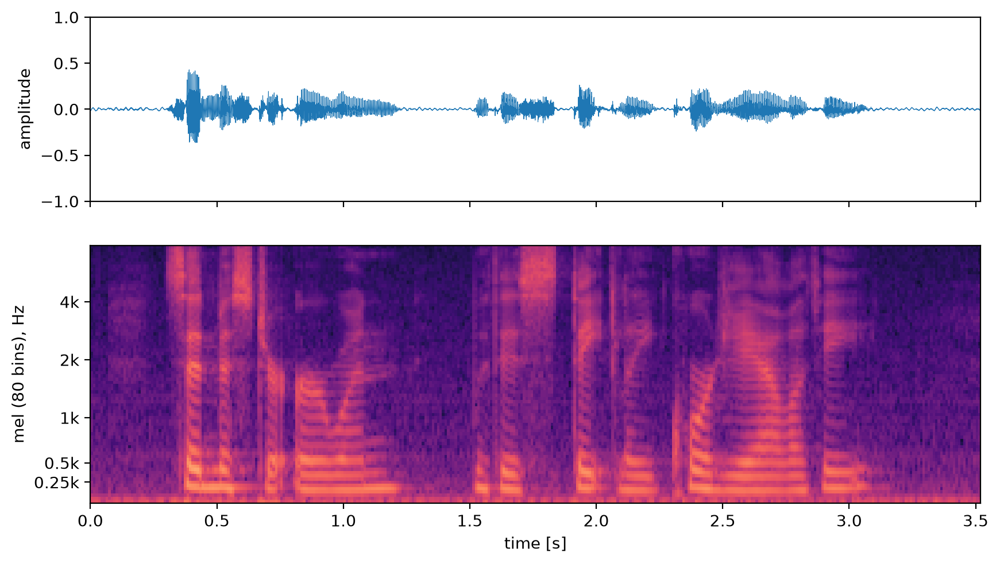
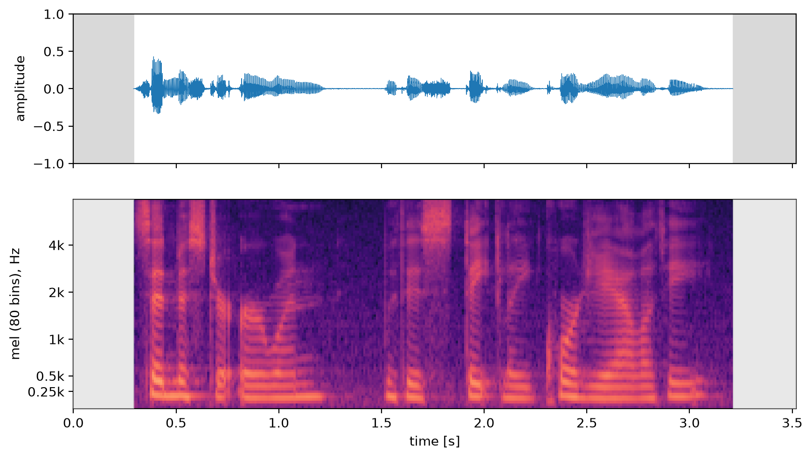
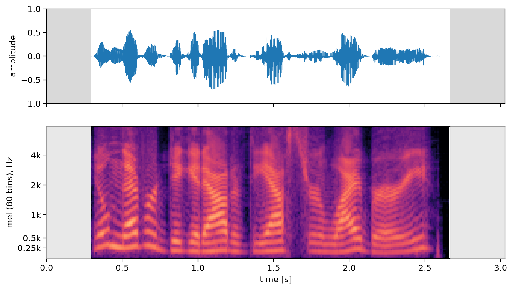
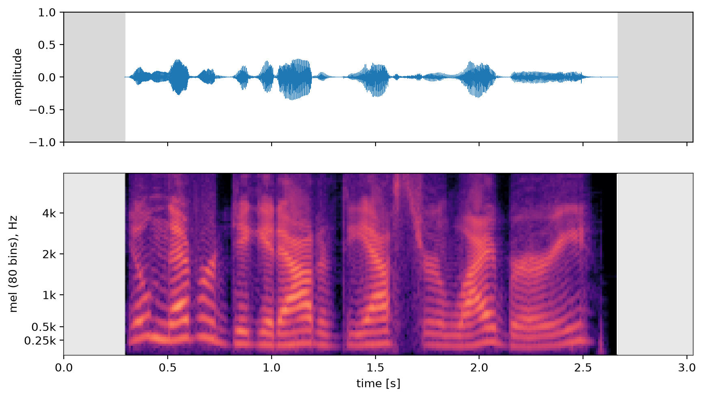

# Tutorial 1. Audio Preprocessing

Before speech recordings can be used to train a TTS model, the audio itself needs some cleaning. In this tutorial we go through three steps:

1. **Removing DC and low-frequency noise** with a high-pass filter
2. **Trimming leading and trailing silence** with a VAD (voice activity detector)
3. **Normalizing the level** with the ITU-T P.56 active speech level


## 0. Reading the audio

We read audio with [`soundfile`](https://github.com/bastibe/python-soundfile), which returns a float signal in the range -1 to 1. File paths are never written in the code; instead, we take the list of utterances from the dataset's manifest (`paths.manifest` in `config.yaml`) through `tutorial_lib.load_corpus`. See "Data" in the README for the manifest format.

```python
import soundfile as sf
from tutorial_lib import load_config, load_corpus

cfg = load_config()  # config.yaml
for utt_id, (audio_path, text) in load_corpus(cfg).items():
    y, sr = sf.read(audio_path)  # float64, [-1, 1)
```

## 1. Removing DC and low-frequency noise: high-pass filter

### What and why

Recordings often contain components that carry no speech information at all:

- **DC offset** (0 Hz): a constant bias introduced by the microphone or the A/D converter. It distorts level measurements and any energy-based processing.
- **Low-frequency rumble**: noise below a few tens of Hz, such as air conditioning, handling noise or wind.

A high-pass filter removes both.

### Code

We use a 4th-order Butterworth high-pass filter at 70 Hz from [`scipy.signal`](https://docs.scipy.org/doc/scipy/reference/signal.html). `sosfiltfilt` runs the filter forward and then backward (zero-phase filtering), so the signal is not delayed.

```python
from scipy import signal

hpf = cfg["audio"]["hpf"]  # config.yaml: order 4, cutoff_hz 70
sos = signal.butter(hpf["order"], hpf["cutoff_hz"], btype="highpass", fs=sr, output="sos")
y = signal.sosfiltfilt(sos, y)
```

### Result

Before:



After:


## 2. Trimming leading and trailing silence: VAD trim

### What and why

- We cut off the silence or noise before and after the speech. **Pauses inside the sentence are kept**, because they are part of the prosody.
- Long leading or trailing silence adds frames that are useless for training and skews the distribution of utterance lengths. In attention-based models such as Tacotron, it also makes the alignment harder to learn.

### Code

We find the speech segments with the neural VAD [`silero-vad`](https://github.com/snakers4/silero-vad) and keep everything from the start of the first segment to the end of the last one, with a 20 ms margin on each side.

```python
import numpy as np
import torch
from scipy import signal
from silero_vad import load_silero_vad, get_speech_timestamps

model = load_silero_vad()
v = cfg["audio"]["vad"]  # config.yaml: threshold 0.5, margin_ms 20, zero_pad_s 1.0

vad_sr = 16000  # silero-vad accepts 8/16 kHz input only
y16 = signal.resample_poly(y, vad_sr, sr) if sr != vad_sr else y
z = round(v["zero_pad_s"] * vad_sr)  # zeros added before and after
x = torch.from_numpy(np.concatenate([np.zeros(z), y16, np.zeros(z)]).astype(np.float32))

ts = get_speech_timestamps(
    x, model, threshold=v["threshold"], sampling_rate=vad_sr, speech_pad_ms=0
)
margin = round(sr * v["margin_ms"] / 1000)
start = round((ts[0]["start"] - z) * sr / vad_sr) - margin  # start of the first speech segment
end = round((ts[-1]["end"] - z) * sr / vad_sr) + margin  # end of the last speech segment
y = y[max(0, start) : min(len(y), end)]
```

### Result


## 3. Normalizing the level: ITU-T P.56 active speech level

### What and why

- If every recording has a different speech level, the model has to learn loudness differences that have nothing to do with the content. We therefore bring every utterance to the same level.
- Normalizing by plain RMS does not work well, because **the RMS depends on how much silence the utterance contains**. A sentence with many pauses gets a low RMS, and its speech ends up too loud after normalization.
- The **ITU-T P.56 active speech level** is computed only over the parts that contain speech. It is the standard used in speech quality assessment, and its customary target level of **-26 dBov** is what we use here (dBov: dB relative to digital full scale).

### How P.56 measures the level (method B)

1. Compute the envelope of the signal (time constant 30 ms).
2. For a range of thresholds, mark the parts where the envelope exceeds the threshold as "active". Activity is extended by a 200 ms hangover after it ends.
3. Find the threshold at which the mean power of the active parts (the active level) is **15.9 dB** above the threshold. That active level is the result.

For comparison, the broadcast loudness standard ITU-R BS.1770 (Python: [`pyloudnorm`](https://github.com/csteinmetz1/pyloudnorm)) also excludes silence, but it gates in 400 ms blocks and applies perceptual weighting (K-weighting). Its unit is LUFS, so its numbers are not comparable to dBov.

### Library: ITU-T STL

The reference implementation of P.56 is a C program in the ITU-T Software Tool Library ([openitu/STL](https://github.com/openitu/STL)). There is no official Python package, so we build the program and call it from Python.

| Program | Behavior |
|---|---|
| `actlev` | **only measures** the active speech level |
| `sv56demo` | measures the level, then **scales the signal to the target level and saves it**. When converting to 16-bit integers it simply cuts off samples that exceed the range (hard clipping) |

Because we want to detect clipping ourselves, **we only measure the level with `actlev` and apply the gain in Python as a float**.

To build `actlev` (WSL/Linux, gcc):

```bash
git clone --depth 1 https://github.com/openitu/STL.git
S=STL/src
gcc -O2 -I$S/utl -I$S/g711 -o actlev $S/sv56/actlevel.c $S/sv56/sv-p56.c $S/utl/ugst-utl.c -lm
```

### Code

```python
import re
import subprocess
import tempfile

import numpy as np


def active_speech_level(y, sr, actlev):
    """ITU-T P.56 active speech level [dBov]. actlev reads 16-bit raw PCM."""
    pcm = np.clip(np.round(y * 32768), -32768, 32767).astype("<i2")
    with tempfile.NamedTemporaryFile(suffix=".raw") as f:
        pcm.tofile(f.name)
        out = subprocess.run(
            [str(actlev), "-q", "-sf", str(sr), f.name], capture_output=True, text=True, check=True
        ).stdout
    return float(re.search(r"ActLev\[dB\]:\s*(-?[\d.]+)", out).group(1))


actlev = cfg["paths"]["third_party"] / "bin" / "actlev"  # built by setup.sh
target_dbov = cfg["audio"]["level"]["target_dbov"]  # config.yaml: -26.0
level = active_speech_level(y, sr, actlev)  # e.g. -25.5 dBov
gain_db = target_dbov - level  # e.g. -0.5 dB
y = y * 10 ** (gain_db / 20)
if np.abs(y).max() > 32767 / 32768:  # if saving as 16-bit would clip,
    ...  # we drop this utterance from the training data
fmt = cfg["audio"]["format"]  # config.yaml: flac
out_path = cfg["paths"]["work"] / "audio" / f"{utt_id}.{fmt}"  # same folder layout as the input
sf.write(out_path, y, sr, subtype="PCM_16")
```

### Result

**0001/example_0001**

Before:


After:



**0002/example_0001**

Before:



After:




## Summary

| Step | Library | Key settings |
|---|---|---|
| 0. Reading | `soundfile` | |
| 1. DC / low-frequency removal | `scipy.signal` (`butter`, `sosfiltfilt`) | 4th-order Butterworth, 70 Hz, zero-phase |
| 2. Silence trimming | `silero-vad` | threshold 0.5, margin 20 ms, 1 s zero padding |
| 3. Level normalization | ITU-T STL `actlev` (alternative: `pyloudnorm`, BS.1770) | -26 dBov, dropped if clipping |

## Running it yourself

Run the commands from the repository folder. See the [README](../README.md) for installation.

- `python src/step1_audio.py` runs all the steps above. It prints the result of each step (trimmed parts, level and gain) and saves the output audio to `../data/preprocess/example_dataset_16k/audio/` (same folder layout as the input) and a log to `audio_log.csv`. It also fills `audio`, `sampling_rate` and `duration` in the output manifest.
- The functions live in `src/tutorial_lib.py` (`highpass`, `vad_trim_bounds`, `active_speech_level`).
- To change the parameters, edit `audio.*` in `config.yaml`.
- To redraw the figures, run `python src/plot_audio.py` (waveform and mel after each step, VAD probability → `figures/`).
