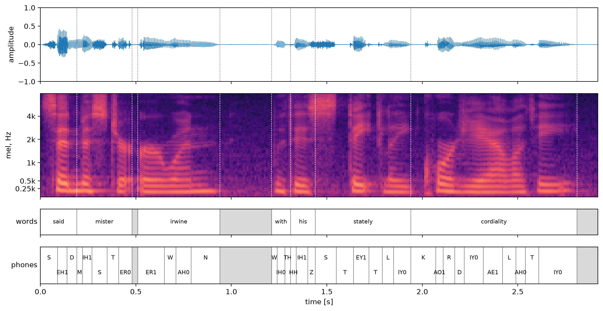
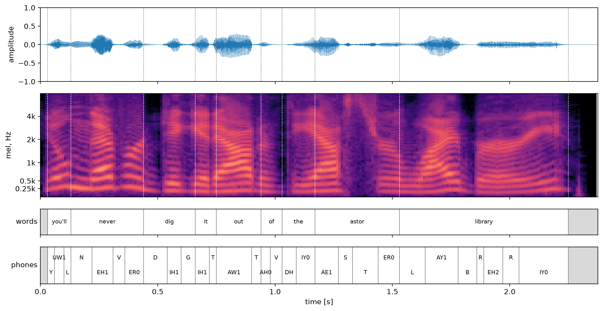

# Tutorial 3. Forced Alignment

Forced alignment matches speech against its transcript to find **when each word and phone starts and ends**. We use the [Montreal Forced Aligner (MFA)](https://montreal-forced-aligner.readthedocs.io/) for this. In TTS training, the alignment is used in two places:

- **Target of the duration model:** how many frames each phone lasts
- **Input of the acoustic model:** how many frames each phone occupies when phone-level linguistic features are expanded to frame level (upsampling)

In this tutorial we treat MFA as a tool and focus on **what goes in and what comes out**, rather than on how it works inside.

```
 speech (audio)     ─┐
 transcript (lab)   ─┼──▶  MFA (mfa align)  ──▶  TextGrid: start/end time of each word and phone
 lexicon            ─┤                          alignment_analysis.csv: alignment quality
 acoustic model     ─┘
```


## 1. Inputs

### Corpus: speech and transcripts

MFA expects each audio file (the output of Tutorial 1) and its `.lab` transcript (the output of Tutorial 2) to have the same name and sit in the same folder.

```
audio/
├── 0001/                     speaker
│   ├── example_0001.flac     preprocessed speech
│   └── example_0001.lab      said mister irwine with his stately cordiality
└── 0002/
    ├── example_0001.flac
    └── example_0001.lab      you'll never dig it out of the astor library
```

- Each sub-folder is a speaker. MFA treats every folder as a different speaker, normalizes features per speaker and adapts its models to each speaker.
- The audio format (wav or flac) and sampling rate do not matter; MFA converts everything to 16 kHz internally.

### Pronunciation lexicon

The lexicon has the format `word <TAB> phone sequence`, with one line per pronunciation when a word has several. It is the lexicon from Tutorial 2 (`lexicon.txt`) merged with the G2P pronunciations of the OOV words.

```
said        S EH1 D
mister      M IH1 S T ER0
irwine      ER1 W AH0 N         ← OOV pronunciation from G2P
irwine      ER1 W AY2 N
with        W IH0 DH
with        W IH0 TH
...
```

The phone notation of the lexicon must match the phone set of the acoustic model. Here both use ARPAbet with stress.

### Acoustic model

The acoustic model decides which phone a stretch of speech sounds like. We download a pretrained one:

```bash
# ACOUSTIC_MODEL: mfa.acoustic_model in config.yaml (english_us_arpa: trained on 982 hours of LibriSpeech, ARPAbet)
mfa model download acoustic "$ACOUSTIC_MODEL"
```

## 2. Running MFA

```bash
mfa align "$CORPUS" "$DICTIONARY" "$ACOUSTIC_MODEL" "$OUT_DIR" --clean
```

| Argument | Meaning |
|---|---|
| `$CORPUS` | corpus folder |
| `$DICTIONARY` | pronunciation lexicon |
| `$ACOUSTIC_MODEL` | acoustic model |
| `$OUT_DIR` | output folder |
| `--clean` | delete temporary files from earlier runs and start fresh |

## 3. Outputs

### TextGrid

MFA writes one `<id>.TextGrid` per utterance, using the same speaker folder layout as the corpus (`textgrids/0001/example_0001.TextGrid`). A TextGrid is Praat's text format. It holds two tiers, **words** and **phones**, each a list of intervals (start, end, label).

`0001/example_0001`:

```
File type = "ooTextFile"
Object class = "TextGrid"
xmin = 0
xmax = 2.92
size = 2
item [1]:
    class = "IntervalTier"
    name = "words"
    intervals: size = 10
    intervals [1]:
        xmin = 0.0
        xmax = 0.19
        text = "said"
    intervals [2]:
        xmin = 0.19
        xmax = 0.48
        text = "mister"
    intervals [3]:
        xmin = 0.48
        xmax = 0.51
        text = ""            ← silence
    ...
item [2]:
    class = "IntervalTier"
    name = "phones"
    intervals: size = 37
    ...
```

Here is the same information arranged by word:

`0001/example_0001`:

| Start | End | Word | Phones |
|---|---|---|---|
| 0.00 | 0.19 | said | S EH1 D |
| 0.19 | 0.48 | mister | M IH1 S T ER0 |
| 0.48 | 0.51 | *(silence 30 ms)* | |
| 0.51 | 0.94 | irwine | ER1 W AH0 N |
| 0.94 | 1.21 | *(silence 270 ms)* | |
| 1.21 | 1.31 | with | W IH0 TH |
| 1.31 | 1.44 | his | HH IH1 Z |
| 1.44 | 1.94 | stately | S T EY1 T L IY0 |
| 1.94 | 2.81 | cordiality | K AO1 R D IY0 AE1 L AH0 T IY0 |
| 2.81 | 2.92 | *(silence 110 ms)* | |

`0002/example_0001`:

| Start | End | Word | Phones |
|---|---|---|---|
| 0.00 | 0.03 | *(silence 30 ms)* | |
| 0.03 | 0.13 | you'll | Y UW1 L |
| 0.13 | 0.44 | never | N EH1 V ER0 |
| 0.44 | 0.66 | dig | D IH1 G |
| 0.66 | 0.75 | it | IH1 T |
| 0.75 | 0.94 | out | AW1 T |
| 0.94 | 1.03 | of | AH0 V |
| 1.03 | 1.17 | the | DH IY0 |
| 1.17 | 1.53 | astor | AE1 S T ER0 |
| 1.53 | 2.25 | library | L AY1 B R EH2 R IY0 |
| 2.25 | 2.376 | *(silence 126 ms)* | |

A few things to notice:

- Times are in **10 ms steps**, MFA's analysis interval. The only exception is the end of the last interval, which is the file length (2.376 s for `0002/example_0001`). Boundaries can also shift by about 10 ms from run to run, even with the same input.
- Silences are stored as empty labels (`""`). The intervals are contiguous and cover the whole file.
- Besides the boundaries, the alignment also decides **which pronunciation candidate was spoken** (`irwine` → `ER1 W AH0 N`, `with` → `W IH0 TH`) and **where the speaker paused**.

### Alignment quality: `alignment_analysis.csv`

MFA also reports, for each utterance, how plausible the alignment is. With a large dataset, these measures help you find badly aligned utterances to check again or drop.

| Measure | Meaning |
|---|---|
| speech log-likelihood | how well the speech matches the aligned phone models; lower is more suspicious |
| phone duration deviation | how far phone durations are from the mean duration of each phone; higher is more suspicious |
| SNR | signal-to-noise ratio |

```
                   speech log-likelihood   phone duration deviation   SNR
0001/example_0001  -46.4                   1.50                       10.2 dB
0002/example_0001  -52.5                   1.61                       13.9 dB
```

## 4. Checking the result

### Code

A TextGrid is a plain text file, so we can read it directly with [`tgt`](https://github.com/hbuschme/TextGridTools):

```python
import tgt

tg_path = cfg["paths"]["work"] / "textgrids" / f"{utt_id}.TextGrid"
tg = tgt.io.read_textgrid(str(tg_path), include_empty_intervals=True)
for iv in tg.get_tier_by_name("words").intervals:
    print(iv.start_time, iv.end_time, iv.text or "(silence)")
```

### Result

Each figure shows, from top to bottom, the waveform, the mel-spectrogram, the words and the phones. Dashed lines mark word boundaries and gray areas are silences.

`0001/example_0001`:



`0002/example_0001`:



- **Boundaries and the mel-spectrogram:** phone boundaries line up with changes in the spectrum. For example, the fricative `S` (in said, stately, astor) appears as strong high-frequency energy, and vowels show visible harmonic stripes.
- **Pauses:** `0001/example_0001` has silences after "mister" (30 ms) and after "irwine" (270 ms). They appear where the speaker actually paused, even though the raw text has no commas. `0002/example_0001` has no silence inside the sentence.
- **Short phones:** in fast stretches such as "with his", phones can be as short as about 30 ms. That is close to the 10 ms alignment resolution, so boundary errors matter more there.


## Summary

| Step | Tool | Output |
|---|---|---|
| 1. Preparing the inputs | outputs of Tutorials 1 and 2 + G2P | audio and `.lab` files under `audio/<speaker>/`, pronunciation lexicon |
| 2. Running MFA | MFA `align` (`english_us_arpa`) | |
| 3. Outputs | | TextGrid (words, phones), `alignment_analysis.csv` |
| 4. Checking the result | `tgt`, matplotlib | word/phone table, figures |

## Running it yourself

Run the commands from the repository folder. See the [README](../README.md) for installation.

- `bash src/step3_align.sh` finds the OOV words, runs G2P and aligns, all in one go. It prints the OOV words with their G2P pronunciations and saves the results to `../data/preprocess/example_dataset_16k/textgrids/`. At the end it fills `textgrid` (the path) and `text_info.phonemes` (the aligned phone sequence, with words separated by `|` and silences as `sil`) in the output manifest.
- `python src/show_alignment.py` prints each TextGrid as a word/phone table.
- To change the acoustic or G2P model, edit `mfa.*` in `config.yaml`.
- To redraw the figures, run `python src/plot_alignment.py` (→ `docs/figures/align_<id>.png`, with "/" in the id replaced by "_").
