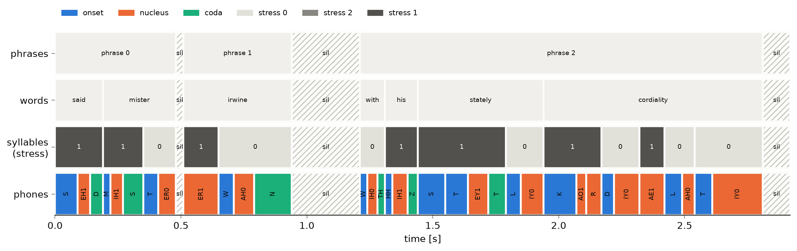
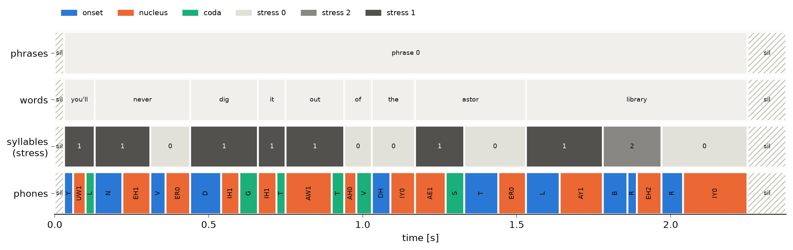
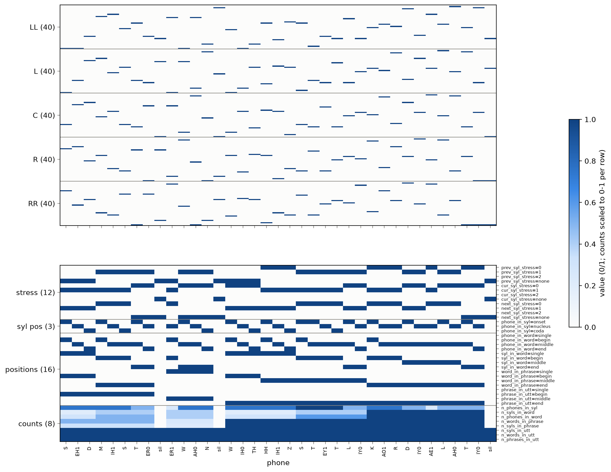

# Tutorial 1. Linguistic Features

A DNN-based SPSS system does not read text or phones directly. Its input is a **linguistic feature vector** for each phone: which phone it is, which phones surround it, and where it sits in its syllable, word, phrase and utterance. In this tutorial we build these phoneme-level features (239 dimensions per phone) from the forced alignment of the [preprocess](../../preprocess/) tutorial:

1. **Phones and words** from the alignment
2. **Syllables** within each word
3. **Phrases** between pauses
4. **The 239-dim feature vector** of each phone

```
 TextGrid (phones, words) ──▶ syllables, phrases ──▶ (N phones × 239) features
```


## 0. Input: the outputs of the preprocess tutorial

We start from the output manifest of the preprocess tutorial (`paths.manifest` in `config.yaml`). For each utterance it records the alignment (`textgrid`), so no file names are written in the code.

```python
from tutorial_lib import load_config, read_manifest

cfg = load_config()  # config.yaml
manifest = cfg["paths"]["manifest"]
for entry in read_manifest(manifest):
    textgrid = manifest.parent / entry["textgrid"]
```

## 1. Phones and words from the alignment

### What and why

The TextGrid has two tiers: **phones** (ARPAbet with stress digits) and **words**. We read the phone sequence with its times, mark every silence as `sil` (adjacent silences are merged), and find for each phone the word it belongs to: the word whose interval contains the middle of the phone. A `sil` belongs to no word.

### Code

```python
from tutorial_lib import phone_word_index, read_alignment

phones, times, words = read_alignment(textgrid)  # e.g. ["S", "EH1", "D", ...]
word_idx = phone_word_index(times, words)  # word index per phone, None for sil
```

## 2. Syllables

### What and why

Stress belongs to syllables, and the position features count syllables, so we need syllable boundaries. We use [`syllabify`](https://github.com/kylebgorman/syllabify) (Kyle Gorman, MIT), which splits an ARPAbet word into syllables by the maximal onset principle. Each syllable has an onset, a nucleus and a coda, and its stress is the stress digit of its vowel.

- Syllables are split **within each word** only.
- Following English phonotactics, `syllabify` sometimes puts a consonant into the nucleus, e.g. the `R` after a vowel (`K AO1 R` in "cordiality"). We keep its output as is.
- A word without a vowel cannot be syllabified; it becomes one syllable made of onsets only, with stress "none".

### Code

```python
from tutorial_lib import load_syllabify

syllabify = load_syllabify(cfg)  # fetched by setup.sh
syllabify(["K", "AO1", "R", "D", "IY0", "AE1", "L", "AH0", "T", "IY0"])
# [(['K'], ['AO1', 'R'], []), (['D'], ['IY0'], []), ([], ['AE1'], []),
#  (['L'], ['AH0'], []), (['T'], ['IY0'], [])]   (onset, nucleus, coda) per syllable
```

### Result

Syllables of each word (separated by `.`):

```
0001/example_0001
  said         S EH1 D
  mister       M IH1 S . T ER0
  irwine       ER1 . W AH0 N
  with         W IH0 TH
  his          HH IH1 Z
  stately      S T EY1 T . L IY0
  cordiality   K AO1 R . D IY0 . AE1 . L AH0 . T IY0
0002/example_0001
  you'll       Y UW1 L
  never        N EH1 . V ER0
  dig          D IH1 G
  it           IH1 T
  out          AW1 T
  of           AH0 V
  the          DH IY0
  astor        AE1 S . T ER0
  library      L AY1 . B R EH2 . R IY0
```

## 3. Phrases

### What and why

We take every stretch of phones between two `sil` as one **phrase**. No part-of-speech tags or syntactic parsing are used: the pauses found by the alignment decide the phrases.

### Result

`0001/example_0001` has three phrases: the speaker paused after "mister" and after "irwine".

```
0001/example_0001  phrase 0: said mister | phrase 1: irwine | phrase 2: with his stately cordiality
0002/example_0001  phrase 0: you'll never dig it out of the astor library
```

The figures show the whole structure on the time axis of the alignment: phrases, words, syllables with their stress, and phones colored by their position in the syllable. Hatched intervals are pauses.

`0001/example_0001`:



`0002/example_0001`:



## 4. The 239-dim feature vector

### What and why

Each phone gets one vector made of 231 categorical features (0/1) and 8 numeric features (counts).

| Type | Feature | Values | Dims |
|---|---|---|---|
| categorical | quin-phone identity (LL, L, C, R, RR: two phones before, the phone, two phones after) | 39 ARPAbet phones + `sil` | 5 × 40 = 200 |
| categorical | stress of the previous, current and next syllable | 0 / 1 / 2 / none | 3 × 4 = 12 |
| categorical | position of the phone in its syllable | onset / nucleus / coda | 3 |
| categorical | position of the phone in its word | single / begin / middle / end | 4 |
| categorical | position of the syllable in its word | single / begin / middle / end | 4 |
| categorical | position of the word in its phrase | single / begin / middle / end | 4 |
| categorical | position of the phrase in the utterance | single / begin / middle / end | 4 |
| numeric | number of phones in the syllable | | 1 |
| numeric | number of syllables and phones in the word | | 2 |
| numeric | number of words and syllables in the phrase | | 2 |
| numeric | number of syllables, words and phrases in the utterance | | 3 |
| | **total** | | **239** |

- **Phone identity** has no stress digit (`EH1` → `EH`); stress is encoded by the syllable features.
- **Context outside the utterance** (LL and L of the first phone, R and RR of the last) is `sil`.
- **A `sil` phone** has no syllable, word or phrase: its position features and syllable/word/phrase counts are all 0, its syllable stress is "none", and only the utterance counts are set.
- **A neighbouring syllable across a pause** or outside the utterance has stress "none".
- **Utterances with an unknown word** (`spn` in the alignment) are skipped.

### Code

`src/linguistic.py` defines the 239 dimensions (`feature_names()`) and computes the matrix:

```python
from linguistic import feature_names, phone_features

ling = phone_features(phones, word_idx, syllabify)  # (N, 239) float32
feature_names()[:3]  # ['LL=AA', 'LL=AE', 'LL=AH']
```

### Result

`python src/show_features.py` decodes each stored vector back into readable values. The first rows of `0001/example_0001` ("said mister"):

```
      phone        LL         L         C         R        RR stress p/c/n       syl   ph/word  syl/word  word/phr   phr/utt   #ph/syl #syl/word  #ph/word #word/phr  #syl/phr  #syl/utt #word/utt  #phr/utt
          S       sil       sil         S        EH         D     -/1/1       ons         B         S         B         B         3         1         3         2         3        14         7         3
        EH1       sil         S        EH         D         M     -/1/1       nuc         M         S         B         B         3         1         3         2         3        14         7         3
          D         S        EH         D         M        IH     -/1/1       cod         E         S         B         B         3         1         3         2         3        14         7         3
          M        EH         D         M        IH         S     1/1/0       ons         B         B         E         B         3         2         5         2         3        14         7         3
        IH1         D         M        IH         S         T     1/1/0       nuc         M         B         E         B         3         2         5         2         3        14         7         3
```

(positions: S = single, B = begin, M = middle, E = end; stress "-" = none)

The whole matrix of `0001/example_0001`, one column per phone. The top panel holds the 200 quin-phone rows, the bottom panel the other 39 rows; the counts are scaled to 0-1 per row for display.



- Most of the matrix is 0: each categorical group has exactly one active value per phone.
- The quin-phone blocks hold the same phones shifted by one column from block to block (C → L → LL, C → R → RR).
- The utterance counts are the same for every phone, and the phrase position changes from begin to middle to end at the two pauses.


## Summary

| Step | Tool | Output |
|---|---|---|
| 0. Input | output manifest of the preprocess tutorial | TextGrid per utterance |
| 1. Phones and words | `tgt` (`read_alignment`, `phone_word_index`) | phone sequence with `sil`, word of each phone |
| 2. Syllables | `syllabify` | onset / nucleus / coda, stress per syllable |
| 3. Phrases | runs between `sil` | phrase of each phone |
| 4. Features | `linguistic.phone_features` | (N, 239) per utterance |

## Running it yourself

Run the commands from this tutorial's folder (`tutorials/spss`). See the [README](../README.md) for installation; the preprocess tutorial must have been run first.

- `python src/extract_linguistic.py` runs all the steps above. It prints the syllables and phrases of each utterance and saves the features to `linguistic/<id>.npz` next to the manifest (`phones`, `ling`), the 239 names to `linguistic/feature_names.txt`, and the path to the field `linguistic` of the manifest.
- `python src/show_features.py` prints the feature table of each utterance.
- The functions live in `src/linguistic.py` (`feature_names`, `annotate`, `phone_features`) and `src/tutorial_lib.py` (`read_alignment`, `phone_word_index`).
- To redraw the figures, run `python src/plot_features.py` (→ `figures/structure_<id>.png`, `figures/features_<id>.png`, with "/" in the id replaced by "_").
